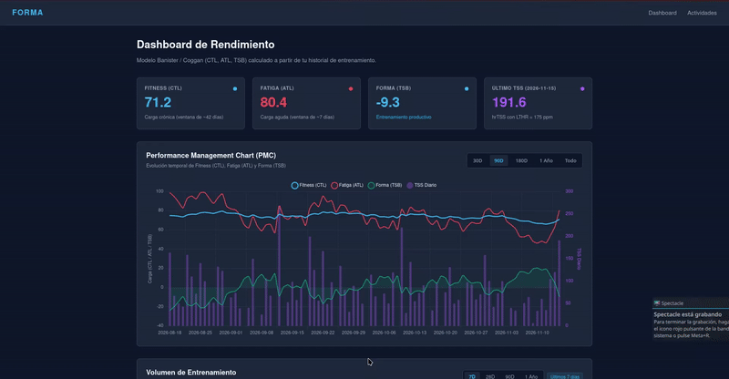

# FORMA

**Personal training-data lab.** Pulls activity history from Strava, applies fitness and fatigue models to your own data, and grows toward an AI coach. Data layer first.

---

## What it does

FORMA is a self-hosted training tracker built for learning — not to replace Strava, but to own your data and understand it.

1. **Import** your full Strava activity history from a data export (no premium subscription required)
2. **Store** it cleanly in your own SQLite database, including GPS and heart rate streams
3. **Analyse** training load with proven models (Banister: fitness, fatigue, form)
4. **Visualise** everything in a minimal personal dashboard

---

## Stack

- **Backend:** Python · Flask
- **Database:** SQLite (SQL directo, no ORM)
- **Data ingestion:** `zipfile` · `csv` · `fitparse` · `gzip`
- **Frontend:** Simple and functional — generated with AI assistance. UI is not the focus of this project.

---

## Project structure

```
forma/
├── app/
│   ├── database/        # Schema and SQL queries
│   ├── ingesta/         # Data pipeline (CSV + FIT streams)
│   │   ├── csv_importer.py
│   │   ├── stream_importer.py
│   │   └── utils.py
│   └── routes/          # Flask blueprints (in progress)
├── templates/           # HTML templates
├── data/                # Strava export ZIP (local only, gitignored)
├── run.py
└── ROADMAP.md
```

---

## Getting started

```bash
git clone https://github.com/yourusername/forma
cd forma
python3 -m venv venv
source venv/bin/activate
pip install -r requirements.txt
```

Place your Strava data export ZIP inside the `data/` folder (request it from Strava: *Settings → My Account → Download your data*), then:

```bash
# Initialise the database
python3 -m app.database.database

# Import all activities from the export
python3 -m app.ingesta.csv_importer
```

---

## Demo



---

## Status

MVP complete: Ingestion pipeline (Strava ZIP + Drop Folder FIT), SQLite database with direct SQL, Banister training load model (hrTSS, CTL, ATL, TSB), and interactive performance dashboard.  
See [`ROADMAP.md`](ROADMAP.md) for the full plan and next milestones.

---

## Why this project

- **Learn by building:** data pipelines → modelling → applied AI, in that order
- **Own your data:** no third-party dashboards, no subscriptions, no lock-in
- **Portfolio:** a working system that shows the full stack from raw data to insight